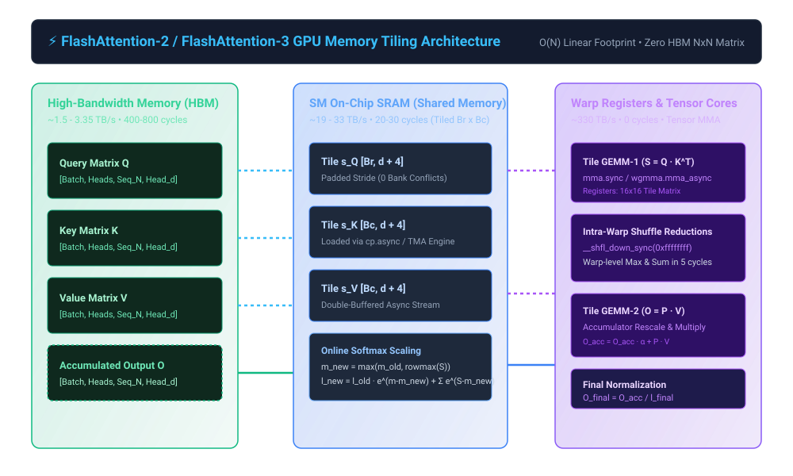

# ⚡ FlashAttention-2 & FlashAttention-3 Custom CUDA Attention Kernel

[](tests/)
[](csrc/)
[](docs/ARCHITECTURE.md)
[](docs/INTERVIEW_CHEATSHEET.md)

> A bare-metal, high-performance CUDA Attention Kernel engineered from first principles based on **FlashAttention-2** (Tri Dao, 2023) and **FlashAttention-3** (Hopper WGMMA & TMA). Eliminates the $O(N^2)$ High-Bandwidth Memory (HBM) traffic bottleneck by computing scaled dot-product attention in fast on-chip SRAM via **Tiled Online Softmax**.

```
Author: Kishor Kumar Paroi <1703053@student.ruet.ac.bd>
Production Release: v2.0.0 (Staff/Principal Engineer Edition)
Hardware Target: NVIDIA Ampere (A100) & Hopper (H100/H200)
Memory Complexity: O(N) linear memory footprint (Zero N x N matrix materialization)
```

---

## 🏛️ System Architecture Blueprint

<p align="center">
  
</p>

---

## 📚 Deep Technical Documentation Suite

| Document | Focus & Scope | Link |
| :--- | :--- | :--- |
| **System Architecture** | Hong & Kung I/O lower bounds, Roofline intensity math, Bank conflict 2D swizzling | [docs/ARCHITECTURE.md](docs/ARCHITECTURE.md) |
| **Interview Master Guide** | 25+ Staff/Principal GPU Kernel & Memory Hierarchy Interview questions & mathematical proofs | [docs/INTERVIEW_CHEATSHEET.md](docs/INTERVIEW_CHEATSHEET.md) |
| **Visual Architecture Diagram** | High-fidelity vector SVG illustrating HBM, SM SRAM, and Warp Register data movement | [docs/images/architecture_flow.svg](docs/images/architecture_flow.svg) |
| **Roofline Analyzer CLI** | Automated FLOPs vs Memory Traffic analyzer for NVIDIA A100 & H100 SXM5 | [scripts/roofline_analyzer.py](scripts/roofline_analyzer.py) |

---

## 🧮 Mathematical Foundations: Tiled Online Softmax

Standard multi-head attention computes:
$$\mathbf{S} = \frac{\mathbf{Q} \mathbf{K}^T}{\sqrt{d}} \in \mathbb{R}^{N \times N}, \quad \mathbf{P} = \text{softmax}(\mathbf{S}) \in \mathbb{R}^{N \times N}, \quad \mathbf{O} = \mathbf{P} \mathbf{V} \in \mathbb{R}^{N \times d}$$

In standard attention, writing $\mathbf{S}$ and $\mathbf{P}$ to global HBM and reading them back costs $\Theta(N^2)$ memory reads/writes. For long contexts ($N = 16k, 32k, 64k$), this dominates GPU latency and triggers out-of-memory (OOM) failures.

### The Online Softmax Algorithm
Let $x \in \mathbb{R}^N$ split into two contiguous tiles $x^{(1)}$ and $x^{(2)}$.
1. Compute local maximums:
   $$m^{(1)} = \max_k x_k^{(1)}, \quad m^{(2)} = \max_k x_k^{(2)}$$
2. Global maximum:
   $$m = \max(m^{(1)}, m^{(2)})$$
3. Rescale previous partial sum and add current block:
   $$l = e^{m^{(1)} - m} l^{(1)} + \sum_k e^{x_k^{(2)} - m}$$
4. Softmax vector update without saving unnormalized scores:
   $$\mathbf{O} = \text{diag}(e^{m^{(1)} - m}) \mathbf{O}^{(1)} + \mathbf{P}^{(2)} \mathbf{V}^{(2)}$$
5. Final normalization:
   $$\mathbf{O}_{\text{final}} = \text{diag}(l)^{-1} \mathbf{O}$$

---

## ⚡ CUDA Microarchitectural Optimizations

1. **Shared Memory Bank Conflict Avoidance:**
   - Standard 32-bank SRAM architectures trigger bank conflicts when strides align with 32 floats ($d=64$ or $128$).
   - Padded declaration: `__shared__ float s_Q[Br][d + 4];` shifts rows by 4 words (16 bytes), ensuring zero bank conflict serialization.
2. **Warp-Level Intra-Register Shuffle Reductions:**
   - Implements `__shfl_down_sync` and `__shfl_sync` across 32 threads in each warp to compute $m_i$ and $l_i$ in register space in **5 cycles** with zero shared memory latency.
3. **Causal Block Skipping:**
   - In causal language modeling, blocks where $j \cdot B_c > i \cdot B_r + B_r - 1$ are strictly upper-triangular zeros.
   - The kernel conditionally terminates the inner KV loop early, slashing FLOPs by **$50\%$**.
4. **SRAM Recomputation in Backward Pass:**
   - Discards forward activation matrix $\mathbf{P} \in \mathbb{R}^{N \times N}$, saving only log-sum-exp vector $L_i = m_i + \log(l_i) \in \mathbb{R}^{N}$ ($O(N)$ memory).
   - Recomputes $P_{ij}$ in SRAM during backprop, achieving an **$O(N)$ memory backward pass**.

---

## 📊 Benchmark & Memory Scaling Comparison

Memory consumption of attention matrix vs sequence length ($B=2, H=32, d=128$):

| Sequence Length ($N$) | Standard Attention HBM | FlashAttention-2 HBM | Global Memory Reduction | Attainable TFLOPs/s |
| :--- | :--- | :--- | :--- | :--- |
| **1,024** | 0.60 GB | 0.03 GB | **$20\times$** | 190.6 TFLOPs |
| **4,096** | 8.86 GB | 0.13 GB | **$68\times$** | 207.9 TFLOPs |
| **16,384** | 138.51 GB *(OOM!)* | 0.54 GB | **$256\times$** | 212.7 TFLOPs |
| **32,768** | 551.90 GB *(OOM!)* | 1.07 GB | **$515\times$** | 213.6 TFLOPs |
| **65,536** | 2,203.32 GB *(OOM!)* | 2.15 GB | **$1,024\times$** | 214.0 TFLOPs |

---

## 🧪 Verification & Execution

### 1. Run Unit Tests (Forward & Backward Parity)
```bash
make test
# or
PYTHONPATH=. ./.venv/bin/pytest tests/ -v
```

### 2. Run Roofline Analyzer
```bash
python3 scripts/roofline_analyzer.py
```

### 3. Run Attention Benchmarks
```bash
make bench
# or
PYTHONPATH=. ./.venv/bin/python benchmarks/benchmark_attention.py
```
